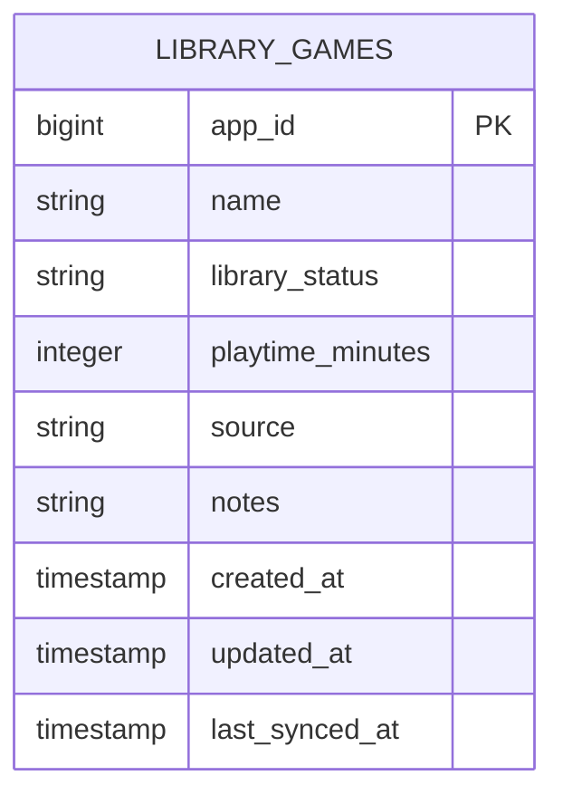

# Phase 2 — Database Design and Data Model

## 1. Project Overview

The Steam Game Library API is a personal game collection manager developed using FastAPI. It allows the user to maintain a collection of Steam games, including games they already own and games they intend to purchase or play in the future.

The application will support two library statuses:

- **Owned** — games that are part of the user's Steam library.
- **Wishlist** — games the user wants to acquire but does not currently own.

The application will retrieve owned-game information and playtime from the Steam Web API where available. Wishlist entries will initially be managed manually. All library records will be stored in the selected cloud database, which will serve as the API's persistent data source.

## 2. Data Entity Identification

### Main Entity: `library_games`

The `library_games` entity represents an individual game saved in the user's personal collection.

Each game is identified by its Steam App ID. A game can have only one library status at a time: `owned` or `wishlist`.

When a wishlist game is acquired, its status can be changed from `wishlist` to `owned` instead of creating a duplicate record.

### Example Record

```json
{
  "app_id": 730,
  "name": "Counter-Strike 2",
  "library_status": "owned",
  "playtime_minutes": 1200,
  "source": "steam",
  "notes": null,
  "created_at": "2026-11-17T05:00:00Z",
  "updated_at": "2026-11-17T05:00:00Z",
  "last_synced_at": "2026-11-17T05:00:00Z"
}
```

This is an illustrative example of the proposed data structure, not an actual database record or verified Steam API response.

## 3. Field Definitions

| Field Name | Data Type | Required | Unique | Description and Validation |
|---|---|---|---|---|
| `app_id` | Integer | Yes | Yes | Steam App ID. Must be a positive integer within the Steam App ID range. Serves as the primary identifier. |
| `name` | String | Yes | No | Game title. Cannot be empty or consist only of whitespace. Maximum 200 characters. |
| `library_status` | Enum / String | Yes | No | Must be either `owned` or `wishlist`. Identifies the game's current collection status. |
| `playtime_minutes` | Integer | Yes | No | Total tracked playtime in minutes. Must be zero or greater. Defaults to zero for newly added games without recorded playtime. |
| `source` | Enum / String | Yes | No | Identifies how the record was added. Accepted values: `steam` or `manual`. |
| `notes` | String | No | No | Optional personal notes about the game. Maximum 1,000 characters. |
| `created_at` | Timestamp | Yes | No | Date and time when the record was created. Generated by the application or database. |
| `updated_at` | Timestamp | Yes | No | Date and time when the record was last modified. Maintained by the application or database. |
| `last_synced_at` | Timestamp | No | No | Date and time of the last successful Steam synchronization. Null for records that have not been synchronized. |

The name and notes length restrictions are proposed application validation rules, not restrictions specified by Steam.

### Important Field Behavior

**`library_status`**

This field replaces the previous `is_owned` boolean.

The accepted values are:

- `owned`
- `wishlist`

Using a status field allows the application to support additional collection states in the future without redesigning the entire data model.

**`playtime_minutes`**

Playtime is stored as an integer representing total minutes. Wishlist entries normally begin with zero tracked playtime. Steam synchronization can update playtime when the game becomes owned and Steam reports playtime information.

**`source`**

This field distinguishes between records added manually and records imported through Steam.

**`last_synced_at`**

This field is optional because manually added wishlist entries are not automatically synchronized from Steam in the initial implementation.

## 4. Relationships and References

The initial version uses one main entity: `library_games`.

A separate users table is not necessary because the project is designed as a single-user personal library.

A separate wishlist table is also unnecessary because owned and wishlist games share the same basic information and can be distinguished using `library_status`.

Likewise, a separate playtime table is unnecessary because the initial implementation only needs to maintain the current accumulated playtime for each game.

This structure reduces unnecessary relationships and keeps CRUD operations straightforward.

### Relationship Rules

1. Each game must have a unique Steam App ID.
2. One App ID can only have one record in the collection.
3. Each game must have exactly one library status.
4. A wishlist game can transition to owned without creating another record.
5. Personal notes should be retained when a wishlist entry becomes owned.
6. Steam synchronization should update imported game information without unintentionally overwriting personal notes.

## 5. Data Validation Rules

The API and selected cloud database will enforce appropriate validation rules.

| Field | Validation Rule |
|---|---|
| `app_id` | Required, positive integer, valid Steam App ID range, unique |
| `name` | Required, trimmed, non-empty, maximum 200 characters |
| `library_status` | Must be `owned` or `wishlist` |
| `playtime_minutes` | Integer greater than or equal to zero |
| `source` | Must be `steam` or `manual` |
| `notes` | Optional string, maximum 1,000 characters |
| `created_at` | Automatically generated |
| `updated_at` | Automatically maintained |
| `last_synced_at` | Optional timestamp, updated after successful synchronization |

### Additional Validation and Business Rules

- Duplicate App IDs must not create duplicate records.
- Creating a record with an existing App ID should return an appropriate conflict response.
- A wishlist game that becomes owned should be updated rather than duplicated.
- Invalid library status values must be rejected.
- Clients must not directly modify system-managed timestamps.
- Partial updates must only modify the fields included in the request.
- Steam synchronization must preserve manually entered notes.
- A failed Steam synchronization must not incorrectly change or delete existing library records.

## 6. Proposed Database Structure

The logical structure consists of one collection or table named `library_games`.

### Entity Diagram



The primary identifier is `app_id`. No foreign keys or separate entity relationships are required in the initial single-user design.

## 7. Database-Specific Representation

The final database provider will be selected after completing Part I.

The proposed logical model can be adapted to the three candidate services:

| Database Provider | Possible Representation |
|---|---|
| Neon | PostgreSQL table named `library_games` |
| Supabase | PostgreSQL table named `library_games` |
| Firebase Firestore | `library_games` collection containing one document per game |

For PostgreSQL-based databases, `app_id` can be implemented as the primary key. For Firestore, the string representation of the App ID can be used as the document identifier.

The final database-specific field types, constraints, indexes, and security configuration will be determined after selecting the provider.

### Proposed Indexes

The following indexes may be useful:

- `app_id`: Unique primary identifier.
- `name`: Supports searching by game title.
- `library_status`: Supports filtering between owned and wishlist games.
- `playtime_minutes`: Supports playtime-based sorting and filtering.

The exact index implementation will depend on the selected database technology.

## 8. Steam Integration and Data Management

Steam and the cloud database will have separate responsibilities.

The Steam Web API will provide owned-game information and playtime where supported. FastAPI will validate and normalize the imported information before storing it in the cloud database.

Wishlist entries will initially be added and maintained manually through the API.

According to Valve's documented `IPlayerService` interface, the available methods include:

- `GetOwnedGames` — retrieves the user's visible owned-game list.
- `GetRecentlyPlayedGames` — retrieves recently played games.
- `GetSingleGamePlaytime` — retrieves playtime information for a particular game.

The reviewed interface does not document a personal wishlist retrieval method. Therefore, automatic wishlist importing is not included in the initial implementation plan.

### Synchronization Rules

1. FastAPI requests the user's owned games from Steam.
2. The application validates the returned game information.
3. Each game is matched using its App ID.
4. If the game does not exist, it is inserted with `library_status = owned`.
5. If the game already exists as an owned entry, its Steam-provided information is updated.
6. If the game already exists as a wishlist entry, its status changes to owned.
7. Existing personal notes are preserved.
8. The synchronization timestamp is updated after successful processing.

A game missing from a synchronization response will not automatically be deleted or changed to wishlist. The application must not assume that every incomplete or failed response means the user no longer owns that game.

Reference: Valve. (n.d.). *IPlayerService Interface*. Steamworks Documentation. Retrieved November 17, 2026, from https://partner.steamgames.com/doc/webapi/iplayerservice?language=english

## 9. Proposed API Operations

The data model supports the following proposed API operations:

| HTTP Method | Endpoint | Purpose | Database Operation |
|---|---|---|---|
| GET | `/api/v1/games` | Retrieve all library games, with optional status and title filters | Read |
| GET | `/api/v1/games/{app_id}` | Retrieve one game | Read |
| POST | `/api/v1/games` | Manually add an owned or wishlist game | Create |
| PATCH | `/api/v1/games/{app_id}` | Update status, notes, or other permitted fields | Update |
| DELETE | `/api/v1/games/{app_id}` | Remove a game from the personal collection | Delete |
| POST | `/api/v1/steam/sync` | Import or update owned games using Steam | Create / Update |

These endpoints are proposed and have not yet been implemented.

## 10. Conclusion

The proposed database structure uses a single `library_games` entity to manage both owned and wishlist games. Replacing a simple ownership boolean with a `library_status` field allows the application to support both categories while maintaining one unique record per Steam App ID.

The design also separates Steam-provided information from personal information such as notes. This prevents synchronization from unnecessarily overwriting user-managed data.

The structure is intentionally simple because the initial application is a single-user personal game library. It supports the required create, retrieve, update, delete, and search operations while remaining adaptable to PostgreSQL-based databases and Firestore.

The final database schema and implementation details will be adjusted after selecting the cloud database provider in Part I.